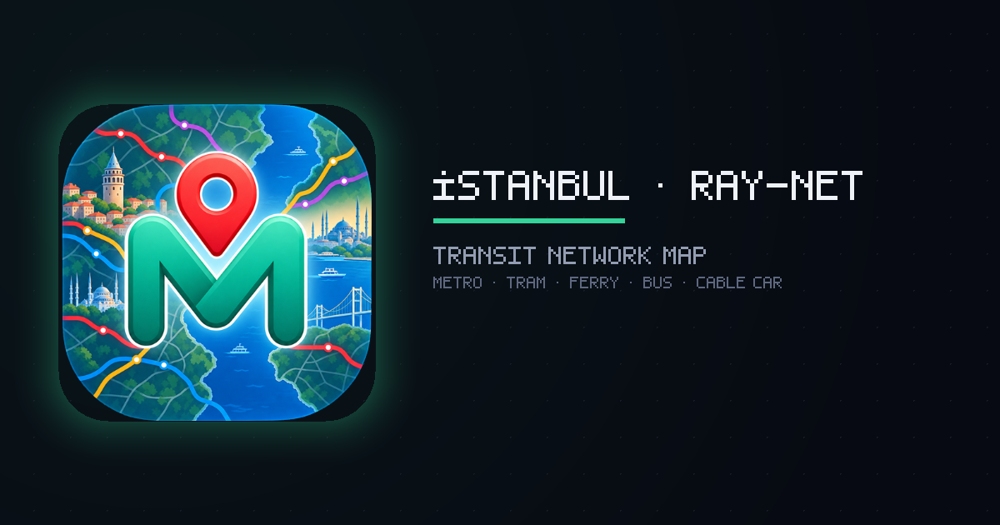

<p align="center">
  
</p>

<h1 align="center">TurkMaps — Transit Network Map</h1>

<p align="center">
  
</p>

An interactive map of Istanbul's transit network (metro, Marmaray, trams, funiculars,
cable cars, Metrobüs, ferries and buses) on a real dark basemap, with animated
carriages (a **simulation** worked out from the published timetables and frequencies, not
vehicle positions), official timetables, multimodal + multi-stop trip planning, service
notices that show how old they are, per-district weather, and a Vision & Expansion tab showing
official future projects. English, Turkish, Arabic and French.

**Live site:** https://hero4mohamed.github.io/Metro-Istanbul-General-City-Map/

## 📲 Install as an app (PWA)
Open the live site on your phone and install it — it gets its own icon, full-screen
mobile UI (bottom navigation + slide-up sheets) and **auto-updates on every deploy**:
- **Android (Chrome/Edge):** tap the **Install app** button in the ◈ Layers sheet
  (or the browser's "Install app / Add to Home screen" menu).
- **iPhone (Safari):** Share → **Add to Home Screen**.

The page, its scripts and typefaces (`vendor/`) and its data are all served from this one site, so
the only things that need the internet are the map tiles and the live lookups (notices, weather,
on-demand bus-route lines). What it contacts, and what is sent, is listed in
[`legal/privacy.html`](legal/privacy.html) and [`DATA-SOURCES.md`](DATA-SOURCES.md).

## Features
- Real OpenStreetMap-derived geometry for every operational line.
- Animated carriages with station dwell + modelled arrivals (a simulation from published frequencies; the app labels it MODELLED).
- **Real bus positions in İzmir and İstanbul**: open a bus line and its real buses are drawn and refreshed every 20 seconds. İzmir's open-data service is read directly (V4.5). İstanbul's (İETT) answers neither web pages nor Cloudflare, so it comes through the app's own relay (`relay/`, V4.5.1): a Cloudflare Worker fed by a small script that must run on a computer in Türkiye; when that computer is off, the app says live buses are not running. No other city publishes positions, and rail and ferries stay simulated.
- **Airports tab** (V4.5.2): choose an airport, then departures or arrivals, and a button opens that live board on the airport's own website. The app has no flight data of its own: airports do not offer their boards to other apps.
- **Ferry notices refresh without the laptop** (V4.5.2): the job on GitHub reads the ferry operator's announcements through the relay, and ferry and rail notices each say how old they are.
- **Boats view** (V4.5): every ferry line in its own colour and its own lane. On a phone, a second press on Map chooses Metro & rail, Buses or Boats.
- Trip planner (Dijkstra over the whole network) with refresh-safe history & favourites.
- **A search for everywhere you might want to go**, on the device: type a place, street, district, neighbourhood, landmark, shop, café, pharmacy, hospital, school or mosque (or just "eczane", "coffee shop", "kadikoy eczane") for any of the six cities. It reads a file of every named street, area and place from OpenStreetMap (about 1.4 MB for İstanbul), so it answers from the first letters, works offline and in Turkish, English, Arabic and French, finds names typed without accents or without spaces, forgives a typo, and ranks the well-known and the near first. The same search backs the map's search box and the trip planner's From/To fields. A public geocoder (Photon) is only a top-up for house numbers and places the file cannot hold, and can be switched off in Settings.
- **Tabs:** Active Network · Vision & Expansion (official + İBB projects, dashed) · Bus Directory (855 İETT lines, click to draw the real route).
- Light/Dark/Satellite basemaps, zoom-responsive line thickness, station service hours.
- **A vector map with names that read.** The day and night maps are drawn on the device (MapLibre, OpenFreeMap vector tiles, the app's own palette), so names are text rather than a picture: only the big places show from afar, and as you zoom in neighbourhoods, streets (running along the road), then shops, cafés, pharmacies, schools and mosques appear, each larger and clearer than the last. Names follow the interface language. A device that cannot draw it, or a tile service that cannot be reached, gets the previous raster map automatically.
- **Announcements for rail, ferries and buses.** Rail faults and ferry notices are scraped into `disruptions.json` (every 30 minutes); İETT's bus notices are read live in the browser. A bus detour that can be checked against the route's stops is drawn on that route; the rest are shown in the operator's own words, never guessed at. Ferry notices are translated by whole-sentence templates that carry every time and date across untouched (a result whose numbers differ from the original is refused); wording they don't know stays Turkish, labelled.
- **Weather for every city and district:** the selected place's scene, sunrise/sunset arc, next 24 hours, 7 days and air quality, with the map showing every district by temperature, rain, wind or air.

## How it's built
The map is generated from data in [`transit_data/`](transit_data/):

| script | input | output |
|---|---|---|
| `process.cjs` | `network.json` (Overpass) | `lines.json` (active lines) |
| `process-ferry.cjs` | `ferry.json`, `piers.json` | `ferry-lines.json` |
| `fetch-planned.cjs` | Overpass: ways tagged `railway=construction\|proposed` | `planned-osm-<city>.json` (not committed) |
| `fetch-planned-facts.cjs` | metro.istanbul project pages | `planned-facts-mi.json` |
| `process-planned.cjs` | `planned-registry.json` + the two above | `planned-lines.json`, `openings.json` |
| `fetch-landuse.cjs` | Overpass: forests, parks, campuses, airports (per city, in small boxes) | `landuse-osm-<city>.json` (not committed) |
| `process-landuse.cjs` | the dump above | `landuse-<city>.json` (painted into the basemap tiles; monthly by `landuse.yml`) |
| `fetch-places.cjs` | Overpass: every named street, area, landmark, shop, café, pharmacy, school, mosque… (per city, in small boxes; the district and neighbourhood outlines once per city) | `places-osm-<city>.json` (not committed) |
| `process-places.cjs` | the dump above | `places-<city>.json` (the search runs on this, on the device; monthly by `places.yml`) |
| `process-bus.cjs` | `bus-probe.json` | `bus-directory.json` |
| `build.cjs` | the JSONs + `app.template.html` | **`index.html`** |

Third-party browser code (MapLibre, its Leaflet bridge, and the map's font files) is shipped in [`vendor/`](vendor/) rather than loaded from a CDN, with versions, hashes and licences recorded in [`vendor/README.md`](vendor/README.md).

### The Vision tab and how it stays current
Future lines are **never hand-drawn**. Three layers are kept apart, and each says where it came from:

- **geometry**: only from OpenStreetMap (planned and under-construction ways). A line that is
  mapped as a single long straight segment is drawn as *indicative* and says so;
- **facts** (contractor, cost, station list, capacity): Metro İstanbul's own project pages;
- **claims** (status, opening target, progress): curated in `transit_data/planned-registry.json`,
  every one with a source and an *as-of* date. When sources disagree the most recent is shown and
  the disagreement is written down, never averaged.

A project that someone maps in OpenStreetMap shows up in the tab by itself, marked *not yet
verified*. To verify it, add it to the registry; the automatic entry then disappears.

```bash
npm run planned     # refetch OSM + Metro İstanbul, merge, rebuild (writes transit_data/planned-report.json)
```
`.github/workflows/planned.yml` does the same every Monday and commits only when something real
changed. `planned-report.json` lists what a person should look at: registry entries OpenStreetMap no
longer matches, status disagreements, entries not re-verified in 120 days, and the unverified list.

### To rebuild after editing the template or data
```bash
cd transit_data
node build.cjs            # regenerates ../index.html
```

### To refresh the source data from OpenStreetMap
The raw Overpass dumps are not committed (large, regenerable). Re-fetch with the
`.overpassql` query files, e.g.:
```bash
curl -s -A "rail-map/1.0" --data-urlencode "data@geom.overpassql" \
  https://overpass-api.de/api/interpreter -o network.json
node process.cjs && node build.cjs
```

## Data sources
OpenStreetMap (geometry & stops, including planned alignments), Metro İstanbul project pages
(future-line facts), İETT (bus directory). Each Vision entry lists its own sources and dates in the panel;
unverified entries say so.
